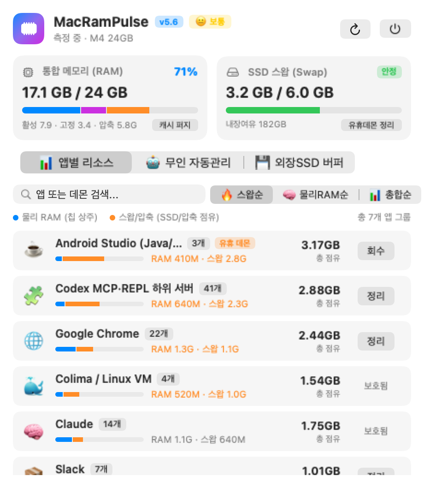
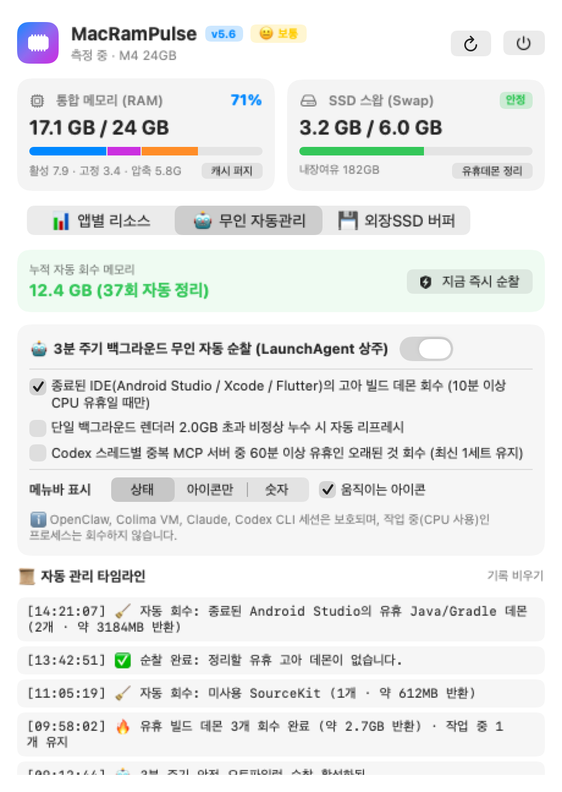
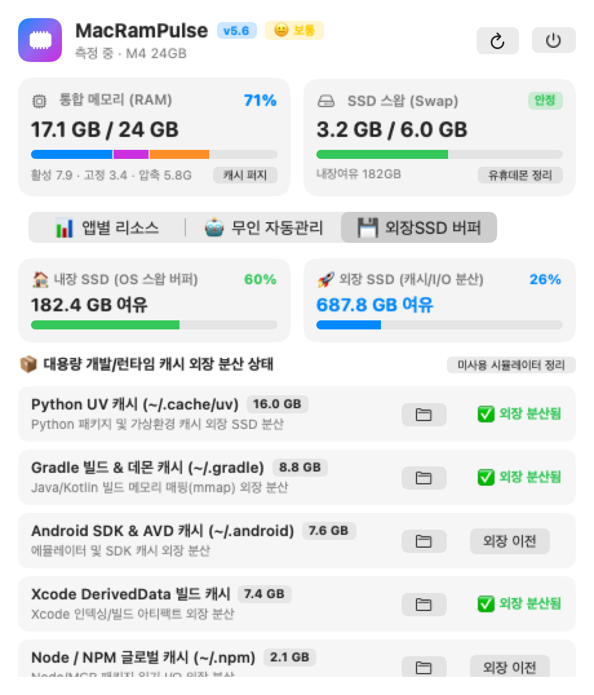

# Mac Ram Pulse

[](https://github.com/maker-KK/Mac-Ram-Pulse/releases/latest)
[](https://github.com/maker-KK/homebrew-tap)
[](https://github.com/maker-KK/homebrew-tap/actions/workflows/tests.yml)


[](LICENSE)

Apple Silicon Mac용 메뉴바 메모리·스왑 모니터이자 안전한 자동 정리 도구입니다.

```bash
brew install maker-KK/tap/mac-ram-pulse
```

<p align="center">
  <picture>
    <source media="(prefers-color-scheme: dark)" srcset="docs/screenshots/apps-dark.png">
    
  </picture>
</p>

macOS의 '활성 상태 보기'는 앱 하나를 수십 개의 헬퍼 프로세스로 쪼개서 보여 줍니다. Mac Ram Pulse는 이 프로세스들을 **앱 단위로 합산**해, 각 앱이 실제 RAM과 SSD 스왑·압축 메모리를 얼마나 쓰는지 보여 줍니다. 또 **확실히 놀고 있는 빌드 데몬만** 골라 자동으로 회수합니다.

## 메뉴바: 숫자 대신 한 단어와 움직이는 맥미니

<p align="center">
  <picture>
    <source media="(prefers-color-scheme: dark)" srcset="docs/screenshots/menubar-states-dark.gif">
    
  </picture>
</p>

메모리 사용률(%)은 macOS가 남는 메모리를 캐시로 채워 두기 때문에 늘 높게 보이고, 실제로 느린지는 잘 알려 주지 않습니다. MRP는 맥이 실제로 버거운지를 **쾌적 · 여유 · 보통 · 버거움 · 위험** 다섯 단계로 보여 줍니다.

- 판정 기준: macOS 메모리 압박 신호, **SSD에서 메모리를 다시 읽어 오는 속도**(버벅임의 실제 원인), SSD로 밀려난 메모리 양, 남은 메모리를 함께 봅니다.
- 나빠지면 바로 표시하고, 좋아질 때는 두 번 연속 확인한 뒤에 바꿔서 경계에서 깜빡이지 않습니다.
- 메뉴바에 마우스를 올리면 이유가 한 문장으로 나옵니다. 예: "SSD로 밀려난 메모리가 많아요".
- 애니메이션은 Core Animation이 그리므로 앱의 CPU 사용은 0%에 가깝습니다. '동작 줄이기' 설정을 켜 두었거나 화면이 꺼져 있으면 멈춘 그림으로 바뀝니다.
- 무인 자동관리 탭에서 표시 방식(상태 / 아이콘만 / 숫자)과 애니메이션 여부를 바꿀 수 있습니다.

## 주요 기능

- **메뉴바 상태 표시**: 위의 다섯 단계 상태를 보여 줍니다. 원하면 `71% · Swp 1.0G` 같은 숫자 표시로 바꿀 수 있습니다.
- **앱별 리소스**: 앱 단위로 물리 RAM과 스왑·압축 추정치를 합산하고, 검색과 정렬을 지원합니다. 앱을 끌 때는 확인을 한 번 더 거칩니다.
  - GUI 앱은 정상 종료(Quit)로 닫고, 데몬에만 종료 신호(SIGTERM)를 보냅니다.
- **무인 자동관리**: 3분마다 순찰합니다. 대상은 아래와 같습니다.
  - Android Studio가 꺼진 뒤 남은 Gradle·Java 데몬
  - 부모 프로세스가 사라진 Dart 런타임
  - Xcode가 꺼진 뒤 남은 SourceKit
  - (옵트인) 2GB를 넘은 렌더러
  - (옵트인) Codex가 채팅 스레드마다 띄우고 끄지 않아 쌓인 중복 MCP 서버
- **CPU 유휴 추적**: 스캔과 스캔 사이 구간마다 CPU 사용량을 비교합니다. 일정 시간 이상 거의 CPU를 쓰지 않은 프로세스만 회수하므로, 진행 중인 빌드나 CI 작업은 건드리지 않습니다.
- **보호 대상**: Claude, Codex CLI 세션, OpenClaw, Colima·Linux VM, 그 밖의 Node 서버는 절대 종료하지 않습니다.
- **외장 SSD 버퍼**: 개발 캐시(`~/.cache/uv`, `~/.gradle`, `~/.android`, DerivedData, `~/.npm`)가 외장 SSD로 옮겨졌는지 상태를 보여 줍니다.

<table>
  <tr>
    <td align="center" width="50%">
      <picture>
        <source media="(prefers-color-scheme: dark)" srcset="docs/screenshots/autopilot-dark.png">
        
      </picture>
      <br><sub><b>무인 자동관리</b>: 순찰 규칙과 회수 기록</sub>
    </td>
    <td align="center" width="50%">
      <picture>
        <source media="(prefers-color-scheme: dark)" srcset="docs/screenshots/ssd-dark.png">
        
      </picture>
      <br><sub><b>외장 SSD 버퍼</b>: 디스크 여유 공간과 캐시 이전 상태</sub>
    </td>
  </tr>
</table>

외부 셸 명령(`ps`, `top`, `vm_stat`)을 호출하지 않습니다. Darwin C API(`host_statistics64`, `sysctlbyname`, `proc_listallpids`, `proc_pid_rusage`, `proc_pidinfo`, `KERN_PROCARGS2`)만으로 동작합니다. 팝오버가 닫혀 있을 때는 메뉴바 제목만 갱신하므로 평상시 CPU 사용률은 0%에 가깝습니다.

## 요구 사항

- macOS 13 이상, Apple Silicon
- Xcode 16 이상 (Swift 6 툴체인. 테스트에 Swift Testing을 사용합니다)

## 설치 (Homebrew)

```bash
brew install maker-KK/tap/mac-ram-pulse
mac-ram-pulse                       # 바로 실행
brew services start mac-ram-pulse   # 로그인할 때마다 자동 실행
```

설치할 때 이 Mac에서 소스를 직접 빌드합니다(약 20초). 그래서 서명되지 않은 앱이어도 Gatekeeper 경고가 뜨지 않습니다. 업데이트는 `brew upgrade mac-ram-pulse`로 합니다.

## 소스에서 빌드

```bash
scripts/build_app.sh            # .build/MacRamPulse.app 생성
scripts/build_app.sh --install  # /Applications에 설치하고 다시 실행
```

로그인할 때 자동으로 실행하려면 `~/Library/LaunchAgents`에 `RunAtLoad` LaunchAgent를 등록하세요.

## 테스트

```bash
swift test
swift test --enable-code-coverage
```

- 테스트는 프로세스 종료, 앱 Quit, 외부 명령, 설정 저장을 모두 가짜(`MonitorEnvironment`)로 바꿔 실행합니다. 따라서 실제 프로세스를 끄거나 설정을 바꾸지 않습니다.
- 통합 테스트는 실제 `node` 자식 프로세스를 띄워 libproc 스캔을 검증합니다. node가 없으면 건너뜁니다.
- README 스크린샷은 실제 프로세스가 아닌 데모 데이터로 그립니다. 다시 만들려면 `MRP_SCREENSHOTS=1 swift test --filter ScreenshotTests`를 실행하세요.

## 구조

```
Sources/MacRamPulseKit/
  ProcessScanner.swift      libproc 스캔, IdleTracker(구간별 CPU 유휴), ProcArgs(argv 파싱)
  ProcessClassifier.swift   앱 그룹·보호 규칙, Codex 중복 MCP 탐지
  SystemMemoryMonitor.swift 상태, 순찰 규칙, 사용자 동작 (MonitorEnvironment로 부수효과 주입)
  PulsePopoverView.swift    SwiftUI 팝오버
  AppDelegate.swift         메뉴바 아이템, MacRamPulseApp.run()
Sources/MacRamPulse/main.swift
Tests/MacRamPulseKitTests/
```

## 참고

- 스왑·압축 사용량은 `ri_phys_footprint - ri_resident_size`로 계산한 **추정치**입니다. 관리자 권한 없이는 다른 프로세스의 압축·스왑 페이지를 직접 읽을 수 없기 때문입니다.
- '외장 SSD 이전' 버튼은 `/Volumes/ExternalSSD/MacOffload/offload.sh`를 호출합니다. 작성자 환경에 맞춘 경로이므로, 다른 환경에서는 경로를 바꿔 사용하세요.

## 라이선스

[MIT](LICENSE)
